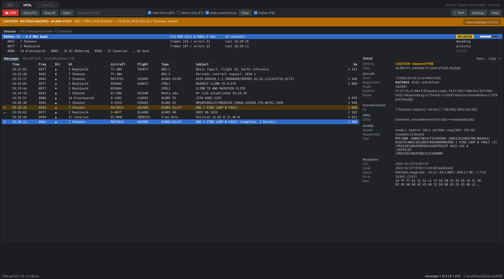
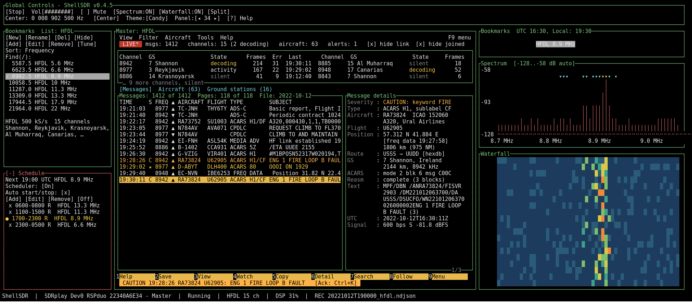

# Mockups

**Informative.** How the views of `../README.md` can look in two front ends. The data in them is illustrative (based on the 2022 logs, partly invented).

| Image | Front end | Source |
|---|---|---|
| `standalone.png` | A desktop GUI: DSQrust (Qt 6) with decoder tabs DSC / HFDL / NAVTEX; sources with their channels, the message list, the detail, the alert banner | `standalone.html` (rendered with Firefox headless, 2000×1110) |
| `shellsdr-workarea.png` | ShellSDR's Work Area (terminal): the HFDL view of a VFO, with the channel table, the message list and details, the F-key bar and the alert line; HFDL band bookmarks and a schedule on the left, the band's spectrum with the channels marked and the waterfall on the right | `shellsdr_workarea.py` → `shellsdr-workarea.html` (rendered the same way, 1920×850) |

